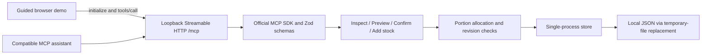

# Architecture

All clients see the same state. The browser has no direct write path to inventory. Preview stores a plan but preserves the pantry revision and quantities. Adding supplies or confirming cooking increments revision, invalidating older previews. Confirm verifies the complete allocation before a new state is persisted; replay fails because the plan is already confirmed. Only the local server process should open a state file.

The MCP endpoint is stateless at the transport/session level; application inventory persists independently. The server permits POST and returns 405 for unsupported methods. Local Host and Origin checks limit browser-origin access. It is not remotely deployed or authenticated for multi-user use.

The guided UI makes deterministic tool requests. No Alexa platform or model is invoked. An assistant connected through MCP is responsible for asking for user approval before mutation calls. This prototype does not provide a trusted out-of-band human approval token.
